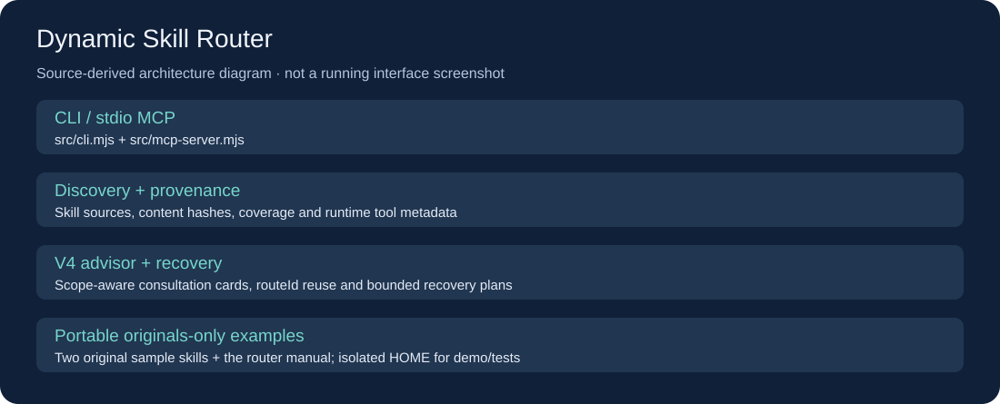

# Dynamic Skill Router

面向 AI 编程工具的本地技能与能力路由器。面对一个任务，它先区分当前请求、未来想法和明确限制，再把相关 Skill、插件或 MCP 工具整理成咨询卡，供宿主决定是否查阅或采用。

它提供 CLI 与 stdio MCP 两个入口，也支持在同一 `routeId` 下继续按阶段检索。路由结果不会自行操作外部工具或扩大用户授权。



> 图按本项目实际模块生成，是架构示意，不是运行界面截图。

## 功能

- 发现配置来源中的 Skill，记录来源、重复项、失效链接、版本哈希及覆盖情况。
- V4 咨询卡区分 `skip / consult / adapt / execute`；支持显式技能名称、阶段查询和同一任务复用。
- 联合处理宿主提供的 `runtimeTools`、插件元数据和只读配置清单；配置存在不等于当前可调用。
- 简单任务可走原生快速路径；遇阻时生成可核验的恢复与资料查询建议。
- MCP 接口提供发现、读取、路由、阶段查询、协作规划及反馈记录；不执行被推荐的业务工具。

## 4.2.1 局部升级

本版保留 4.2 的自动排名、请求切分与原生快路，新增完整请求与宿主解释分列、只收紧的调用范围、20 项方法目录及按需 0–2 张咨询卡。显式 qualityProfile 调整建议深度；反馈按模型、当前内容哈希、90 天时效与撤销状态隔离。

宿主可用 taskContext.capabilityRequests 提交有当前原文字面证据的精确工具名，结果进入独立咨询通道，不变成用户点名或执行授权。接口和条件见 [V4 契约](skill/dynamic-skill-router/references/router-contract-v4.md)。

这次发布范围不包含 RC26 的扩展自动解析、排序与来源闭包；不宣称完成专业十二领域验证或取得统一质量增益。旧实验分支和 Draft PR 的结果不代表本版通过。

## 技术栈

Node.js **22+**、ES modules；锁定依赖 `@modelcontextprotocol/server`、`smol-toml`、`zod`。MCP 集成测试使用 `@modelcontextprotocol/client`。本仓库不需要云端 API Key。

## 快速上手

```powershell
git clone https://github.com/yangwei251003/dynamic-skill-router.git
cd dynamic-skill-router
npm ci --ignore-scripts
npm run health
npm run list
npm run demo
```

三个演示命令会先验证临时 HOME 隔离，再启动子进程。默认仅扫描仓库自带的两个原创示例 Skill 和路由器自身 Skill；不连接第三方服务，不读取你的个人技能库、账号配置或历史记录。输出中的本地路径属于你自己的克隆目录。

`npm run demo` 应返回 `ok: true`，并选出 `example-code-review`。`examples/runtime-tools.json` 是合成元数据，仅展示数据格式，不是真实会话工具清单，也不代表示例工具可被执行。

### 直接使用 CLI

```powershell
node src/cli.mjs route '使用 example-code-review 审查代码' --host generic --contract-version 4 --dry-run --context
node src/cli.mjs health --host generic --contract-version 4
```

省略 `--contract-version 4` 会保留原 V3 兼容行为。若要传入完整 JSON，可以通过标准输入使用 `--input-json`，不要把私人信息拼接进 shell 命令。

### MCP 接入

需要支持 stdio MCP 的 AI 工具。命令为 `node`，参数为你本机克隆目录中 `src/mcp-server.mjs` 的**绝对路径**。Codex 的安全示例见 [mcp-config.toml](examples/mcp-config.toml)；替换 `CORE_PATH` 后，手工合并该段到自己的有效配置，保留其他设置。

启动脚本只提供本地 MCP 服务，不自带网络部署或宿主账户。使用 `host: generic` 时默认读取仓库示例来源；选择 `host: codex` 或显式指定配置来源，可能只读检查对应机器的配置与插件登记。真实宿主应提供本次会话的 `runtimeSkills` 和 `runtimeTools`；复制示例元数据不能证明工具在线。

## 配置自己的技能来源

1. 先阅读 [配置说明](docs/configuration.md)。
2. 将自己有权使用的 Skill 目录加入 `config/skill-sources.json`，或通过代码 API 的 `sources` 参数显式传入。
3. 用 `health/list/coverage` 检查覆盖情况，再进行路由。
4. 不把自己的技能注册表、配置、反馈、日志或技能正文提交到此公共仓库。

## 目录结构

```text
src/                  CLI、MCP、发现、路由、恢复与维护源码
skill/                路由器本身的Skill入口与契约
config/               通用示例来源与未知状态宿主模板
examples/             原创示例Skill、示例注册表和合成工具元数据
scripts/              隔离运行和无外部动作的演示
tests/                可移植的既有回归与MCP测试
docs/                 结构示意、配置和验证范围
```

原机器的能力仪表板、第三方 Skill 全文、个人注册表、真实账号配置、运行日志、反馈和历史请求回放未收录。排除范围见 [PROVENANCE.md](PROVENANCE.md)。

## 验证

```powershell
npm test
npm run test:v421
```

测试同样在临时 HOME 中运行。4.2.1 公开回归41项及新增14项通过；独立检查16项/31断言通过，原36个请求的既有路由字段保持一致。新 Codex 会话从真实生产配置读回4.2.1，两个短任务及文件读回通过。详情和限制见 [验证记录](docs/validation.md)。这些结果不证明所有领域的质量或成本改善；已有桌面会话可能仍保留旧连接。

## 维护边界

`src/` 保留旧版同步、宿主规则安装与恢复源码，供维护者按需使用。这些维护入口可能写文件；演示和 `npm test` 不会把它们应用到真实用户目录。公开的宿主模板默认 `syncManaged/catalogManaged=false`、模型与能力未知。不要未经核实就把旧机的能力状态复制到新机器。

## 更新与许可

见 [CHANGELOG.md](CHANGELOG.md)。自有代码与文档采用 [MIT](LICENSE)；依赖许可与来源见 [THIRD_PARTY_NOTICES.md](THIRD_PARTY_NOTICES.md) 和 [PROVENANCE.md](PROVENANCE.md)。
