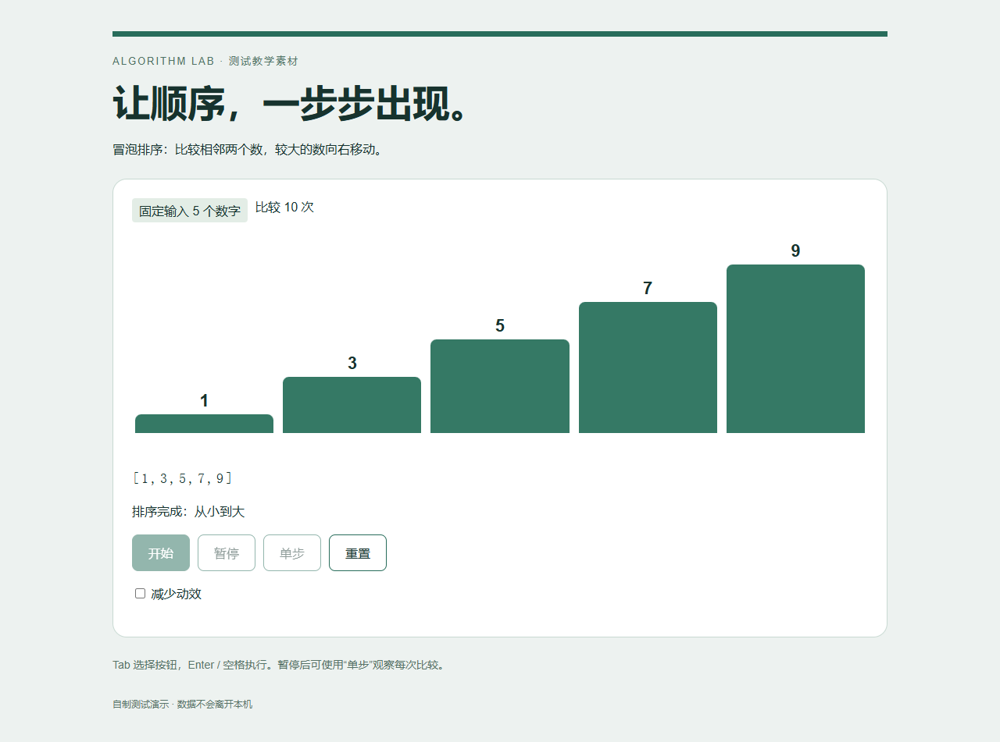

# 三组真实成果对照：2026-10-30

本轮比较旧4.2.0路由、冻结的4.3.0-rc.1候选，以及最小必要路由。三组分别由新的原生子 Agent 执行相同冻结任务与基本约束，继承同一父会话模型配置，没有显式模型覆盖。后端精确模型版本、令牌与费用不可核验；部分运行条件也不完全一致。因此这是本机观察，不是严格控制变量实验，更不是所有任务提升的保证。

## 实际交付范围

下表使用作者逐项运行、文件读回和现场观察的记录。PASS 表示该案例的既定要求通过；BLOCKED 表示存在明确阻塞或关键交付缺失；NOT_TESTED 表示目标设计尚未执行。分项成功不会覆盖整类缺口。

| 领域 | 旧路由 | 候选路由 | 最小必要路由 | 已有证据与主要缺口 |
|---|---|---|---|---|
| 网页、交互与算法可视化 | PASS | PASS | PASS | 真实浏览器排序、暂停、重置、键盘、窄屏与减少动态效果检查 |
| 应用、后端与数据处理 | PASS | PASS | PASS | 清洁4条、异常2条；月金额50/5、合计55；重复执行与HTTP响应一致 |
| 游戏 | PASS | PASS | PASS | 实际输入通关，检查障碍、边界、重开；屏幕按钮点击不等于实体触屏硬件测试 |
| 数学、算法与实验 | PASS | PASS | PASS | 每组90条真实计时、原始数据、中位数/IQR；不把本机计时推广为普遍速度结论 |
| 论文与 LaTeX | BLOCKED | BLOCKED | BLOCKED | TeX源文件存在；编译实际尝试因资源包获取失败或超时，没有可验收PDF |
| 调研、商业与比赛方案 | PASS | PASS | PASS | 一页选型PDF、官方文档与许可原文；开源许可和托管服务收费分别处理 |
| Word、PDF、简历与报名材料 | BLOCKED | PASS | PASS | 候选和最小组有原生Word导出PDF；旧组只有DOCX，原生打开超时 |
| PPT 与教学材料 | PASS | PASS | PASS | 每组5页可编辑PPTX、原生PowerPoint导出与逐页看审 |
| 视频、图像与音频 | BLOCKED | BLOCKED | BLOCKED | 三组有可编辑场景和声音准备；候选和最小组另有12秒独立预览，但没有完整OpenFilm交付及连续看审、听审 |
| 电路与 PCB | BLOCKED | BLOCKED | NOT_TESTED | 旧/候选首次Bridge探测失败；最小组后来验证官方Bridge连接，但未创建原理图或PCB，不计设计完成 |
| CAD、PLC 与工程软件 | BLOCKED | BLOCKED | BLOCKED | 三组CAD STEP重载、尺寸和孔位验证通过；PLC原生创建/编译未完成，遇启动超时或访问许可提示 |
| Skill、MCP、桌面与文件操作 | PASS | PASS | PASS | 原环境实际stdio初始化、工具发现/调用、文件散列保护及原生记事本读回；另见盲审复现限制 |
| **合计** | **7 PASS / 5 BLOCKED** | **8 PASS / 4 BLOCKED** | **8 PASS / 3 BLOCKED / 1 NOT_TESTED** | **完成数量不等于质量总分或因果收益** |

电路组的后续连接测试改变了观察到的环境；下一轮必须让三组从相同的已连接基线开始。视频检查没有切换可能含未保存手改的共享工作台项目；独立预览的技术参数通过也不能替代工作台重开、编辑、完整看审和听审。PLC权限提示没有被自动批准，真值表检查不能冒充原生编译、仿真或实机验证。

下图来自候选组原创排序页的实际浏览器测试产物，仅展示一个受测页面，不是路由器界面，也不能单凭截图推断整体质量提升。页面无外部素材、真实人员资料或桌面其他窗口。

## 独立盲审

独立审阅者收到去除路由条件和作者结论的匿名成果包，未获知组别映射。审阅包含真实无头浏览器操作、订单处理与HTTP复跑、计时统计重算、额外排序正确性检查、官方许可原文核对以及全部15页PPT与已有PDF的实际渲染查看。审阅前后532个交付文件散列一致。

盲审共27项，20项可评分、7项 BLOCKED。视频与电路未进入该盲审包，CAD/PLC未评分。四个维度——目标完成度、正确性与证据、表达或交互质量、可继续使用程度——各按1至5分等权；下表为对应案例均分，不跨缺失领域汇总。

| 案例 | 旧路由 | 候选路由 | 最小必要路由 | 独立观察 |
|---|---:|---:|---:|---|
| 网页算法可视化 | 4.50 | 4.50 | 4.50 | 三组硬功能均通过，仅有风格差异不足以判断优劣 |
| 数据处理与接口 | 4.50 | 4.75 | 4.50 | 三组数值可靠；异常源行号、输入可配置性影响复用质量 |
| 游戏 | 4.25 | 4.50 | 4.50 | 旧组棋盘行高不一致；三组实际通关流程通过 |
| 数学算法实验 | 4.50 | 4.50 | 4.50 | 正确性、90条实际计时和统计均通过，不比较共享机器绝对时长 |
| LaTeX | BLOCKED | BLOCKED | BLOCKED | 均缺编译PDF，不评分 |
| 调研选型 | 4.25 | 4.50 | 4.75 | 三组官方证据符合硬要求；旧组字号偏小，最小组证据选择更贴近实施 |
| Word/PDF | BLOCKED | 4.75 | 5.00 | 旧组缺PDF；最小组表格层级更清楚 |
| 教学PPT | 5.00 | 4.75 | 4.00 | 旧组流程分支和练习布局更清楚；最小组代码缩进与箭头遮挡需改进 |
| Skill/MCP/桌面 | BLOCKED | BLOCKED | BLOCKED | 受盲审包的依赖与桌面证据范围限制，不计总分 |

Skill/MCP/桌面的两层结果不能混用：三组原环境都完成了真实MCP和记事本读回；为保护其他用户标签等隐私，桌面读回资料没有进入匿名包。旧组的自包含MCP在包内再次成功，候选与最小组分别遇二进制依赖和SDK元数据缺口。盲审包无法完整复跑是可移植性/证据包装缺口，不能据此否认原环境的实际执行，也不能把原环境成功说成独立复现通过。

## 结论与后续

候选在部分成果上表现较好，旧版和最小必要路由也各有优势。没有完整覆盖领域的有效总分，不满足“整体至少提高5/100”的发布证明；未执行每个关键案例三次独立模型重复，也未完成分别去掉排名修复、方法卡、记忆改动的最终成果消融。已做的三次确定性路由重复不补足这些缺口。

完整发布决定仍为 **FAIL，保留生产4.2.0**。稳定偏好和按需方法资料作为独立改动生效，范围见[发布与生效说明](v43-evaluation.md)。下一轮需补齐环境基线、完整专业交付、可重建依赖和独立重复，再重新验证新的保留案例。不得在已经消费的保留集上继续调参后宣称独立泛化通过。

公开页仅保留去标识的汇总。个人配置、原始工具清单、任务运行路径、桌面截图、未核实再分发许可的声音或第三方原文快照不进入公共仓库；私人证据包仍保留逐项验证和文件散列。公开仓库的代码回归可复现范围与本机成果观察不同。
